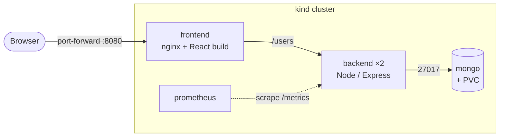
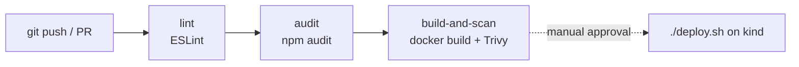

# 🌟 Welcome to **Your Benchmark**! 🌟

This project features a **collection of engaging memory and reaction tests** designed to challenge and enhance your cognitive abilities. 

---

### 📋 Features

- **User Registration and Login**  
  Securely register and log in to track your progress and scores.

  

---

### 🧠 Tests Included

1. **Reaction Time Test**  
   Measure how quickly you can respond to visual stimuli.
   
   

2. **Number Memory Test**  
   Challenge your ability to memorize and recall numbers.
   
   

3. **Verbal Memory Test**  
   Enhance your verbal recall skills.
   
   

4. **Visual Memory Test**  
   Test your ability to remember visual patterns and images.
   
   

5. **Sequence Memory Test**  
   Recall sequences of numbers or colors in the correct order.
   
   

6. **Aim Trainer Test**  
   Improve your focus and accuracy with this fun aiming challenge.
   
   

---

### 🎨 Design

- **Beautiful and Responsive Design**  
  This application features a **modern and responsive design** built with Material-UI, ensuring a **seamless user experience** across all devices.

---

### 🚀 Technologies Used

- **Frontend:** React
- **Backend:** Node.js, Express
- **Database:** MongoDB

---

### 💾 Backend Implementation

- **Score Tracking:**  
  Each user's scores for every test are securely saved, allowing for easy tracking of progress over time.

  

---

## ⚙️ DevOps setup

The app runs on a local Kubernetes cluster ([kind](https://kind.sigs.k8s.io/)) with CI on GitHub Actions, Prometheus monitoring and basic runtime security. The baseline before these changes is commit `5fc003e` on `main`.

### Architecture



| Component | Image | Kubernetes objects (`k8s/`) |
|---|---|---|
| Frontend | `ybm-frontend:<git-sha>` (`Dockerfile`) | Deployment, Service |
| Backend | `ybm-backend:<git-sha>` (`server/Dockerfile`) | Deployment (2 replicas), Service, headless Service for scraping |
| Database | `mongo:7` | Deployment, Service, PVC, NetworkPolicy |
| Monitoring | `prom/prometheus:v2.55.1` | Deployment, Service, ConfigMap (scrape config + alerts) |

nginx serves the React build and proxies `/users` to the backend, so the browser talks to a single origin. Every Service is `ClusterIP`; nothing is exposed outside the cluster except through `kubectl port-forward`.

### Run it

Prerequisites: Docker, kind, kubectl, git, openssl.

```sh
./deploy.sh
kubectl port-forward svc/frontend 8080:8080      # app: http://localhost:8080
kubectl port-forward svc/prometheus 9090:9090    # metrics: http://localhost:9090
```

`deploy.sh` creates the kind cluster and the `ybm-secrets` Secret if they are missing, builds both images tagged with the current commit SHA, loads them into kind, applies `k8s/` and waits for the rollout. Rerunning it performs a rolling update.

Check it is healthy:

```sh
kubectl get pods                         # all Running, READY 1/1
kubectl get deploy -o wide               # IMAGES column shows the deployed commit
kubectl logs -l app=backend --prefix     # one JSON line per API request
```

Then register, log in, finish the Aim Trainer test and open the profile page to see the saved score.

### CI/CD



`.github/workflows/ci.yml` runs on every push and pull request. Each job starts only if the previous one passed:

| Job | Fails when |
|---|---|
| `lint` | ESLint reports an error (warnings are shown only) |
| `audit` | Backend runtime dependencies have a high or critical vulnerability |
| `build-and-scan` | An image fails to build, or Trivy finds a fixable critical vulnerability |

Deployment is manual. GitHub cannot reach a cluster on a laptop, so running `./deploy.sh` is the approval step. Both CI and the cluster use the commit SHA as the image tag, so the running version maps back to its CI run.

### Release and rollback

- **Rolling update:** the backend runs 2 replicas, and readiness probes keep traffic on ready pods during an update.
- **Rollback:** `kubectl rollout undo deployment/backend` returns to the previous image. `kubectl rollout history deployment/backend` lists revisions.
- **Version check:** `kubectl get deploy backend -o jsonpath='{..image}'`.

### Observability

- **Health:** `/healthz` (liveness: the process is up) and `/readyz` (readiness: MongoDB is connected). When MongoDB is down the backend leaves the Service instead of restarting.
- **Metrics:** `/metrics` exposes `http_requests_total` (method, route, status), `http_request_duration_seconds` and Node.js process metrics. Prometheus scrapes each backend pod.
- **Alerts** (visible at `localhost:9090/alerts`): `BackendDown` when a pod stops answering for 1 minute, and `HighErrorRate` when over 5% of API requests return 5xx for 5 minutes.
- **Logs:** `kubectl logs`, with one JSON line per request.

Healthy means both backend targets are `UP`, `/readyz` returns 200, the 5xx rate is under 5%, and logins succeed.

### Security

- Secrets (`MONGODB_URI`, `JWT_SECRET`) live in a Kubernetes Secret created at deploy time, never in git.
- Every container runs as a non-root user, with privilege escalation disabled and all Linux capabilities dropped.
- A NetworkPolicy lets only backend pods connect to MongoDB.
- Passwords are hashed with bcrypt and never returned by the API.
- CI blocks vulnerable backend dependencies and images with critical vulnerabilities.

### Evidence

All evidence comes from commit `e5b6b35`, in [`screenshots/`](screenshots/):

| File | Shows |
|---|---|
| [`01-cluster-state.txt`](screenshots/01-cluster-state.txt) | Pods, Services, PVC and NetworkPolicy; deployed image tags |
| [`02-rollback.txt`](screenshots/02-rollback.txt) | Rollback from `e5b6b35` to `db3bf95` and forward again |
| [`03-security.txt`](screenshots/03-security.txt) | Non-root users; NetworkPolicy allows backend and blocks other pods |
| [`04-fault-recovery.txt`](screenshots/04-fault-recovery.txt) | MongoDB stopped: readiness fails and logins return 502; MongoDB restored: recovery with data intact |
| [`05`](screenshots/05-app-register.jpg)–[`08`](screenshots/08-app-score-saved.jpg) | User journey: register, log in, finish a test, see the saved score |
| [`09`](screenshots/09-prometheus-targets.jpg)–[`11`](screenshots/11-prometheus-alerts.jpg) | Prometheus targets, request counts by route and status, alert rules |
| [`12`](screenshots/12-ci-runs.jpg)–[`13`](screenshots/13-ci-run-e5b6b35.jpg) | Passing CI runs, including the deployed commit |
| [`14-logs-and-metrics.txt`](screenshots/14-logs-and-metrics.txt) | JSON request logs and raw metrics from that journey |

### Known limitations

- kind is a single-node local cluster, not production. Production would use a managed cluster, a registry, an Ingress with TLS and a managed database.
- Images are built locally by `deploy.sh`, not pulled from a registry. `deploy.sh` tags images with the last commit, so uncommitted changes deploy under the previous SHA.
- MongoDB has no password and runs as one replica. Only the NetworkPolicy restricts access to it.
- The `/users` API does not check the JWT, so any client that reaches it can read or change users.
- There is no tracing and no Alertmanager. Alerts are visible only in the Prometheus UI.
- The frontend `npm audit` only reports. Its issues are in `react-scripts` build tooling, which does not ship in the nginx image.
- The Reaction Time test never saves results. This bug existed before these changes.
